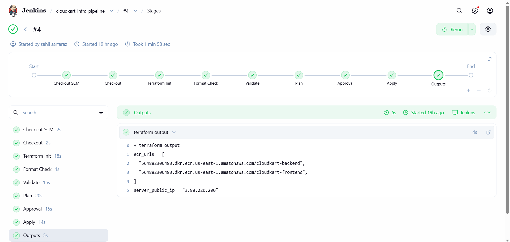
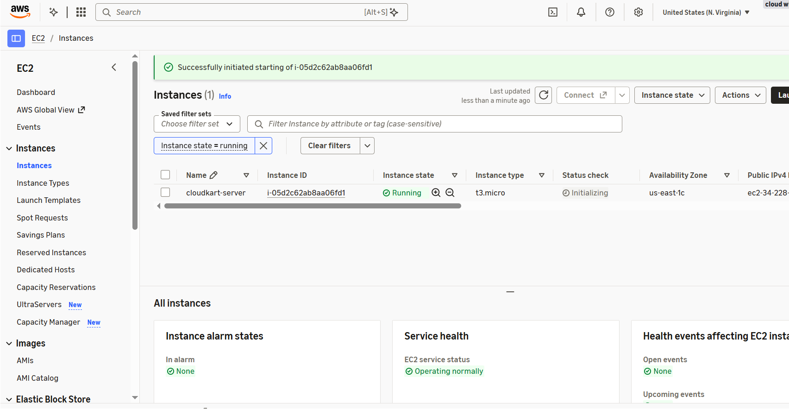
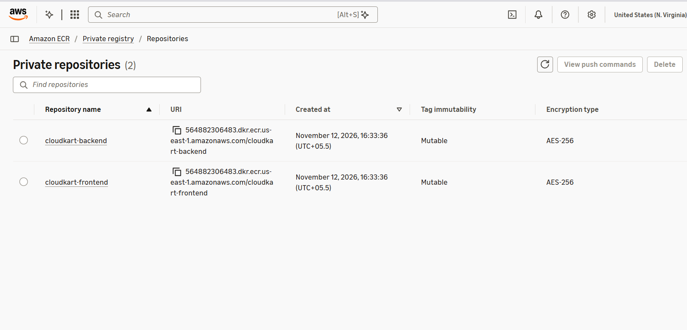

# CloudKart Infrastructure

Terraform code and a Jenkins pipeline that provision the AWS resources for the CloudKart Platform.

## Resources
- EC2 instance, built from a reusable module (modules/ec2)
- Two ECR repositories (backend and frontend)

## Infrastructure pipeline (Jenkins)
- Checkout
- Terraform init
- Format check (terraform fmt -check)
- Validate (terraform validate)
- Plan
- Manual approval gate
- Apply
- A DESTROY parameter runs a destroy plan, an approval gate and a destroy, so resources can be removed safely

AWS keys are stored as Jenkins secret credentials. State files and tfvars are excluded through .gitignore.

## Tech
Terraform, AWS (EC2, ECR), Jenkins

## Screenshots

## Related repos
- cloudkart-app: application and CI pipeline
- cloudkart-deploy: Kubernetes manifests and the deploy pipeline
